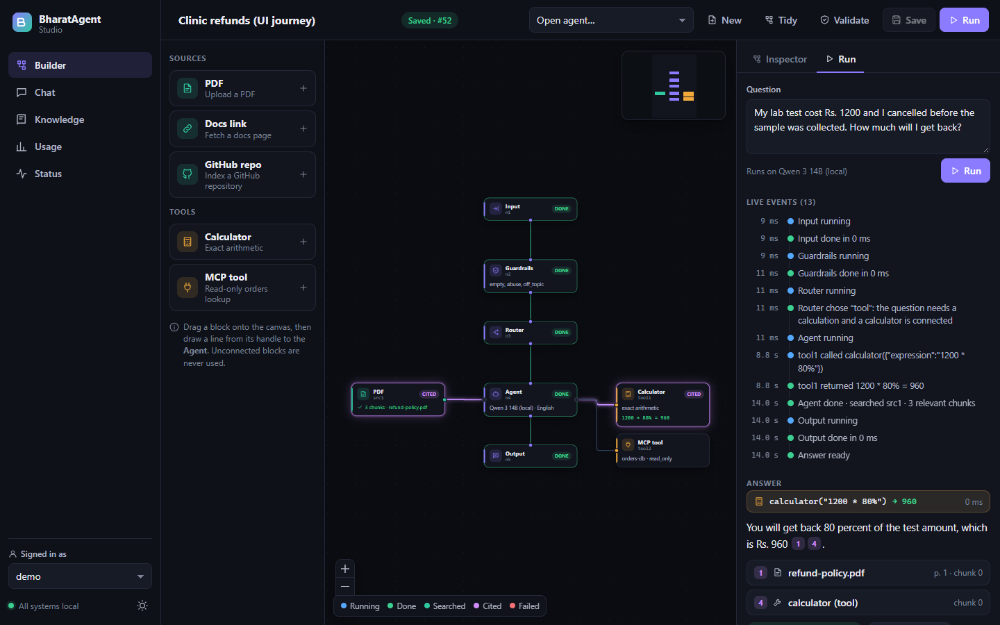
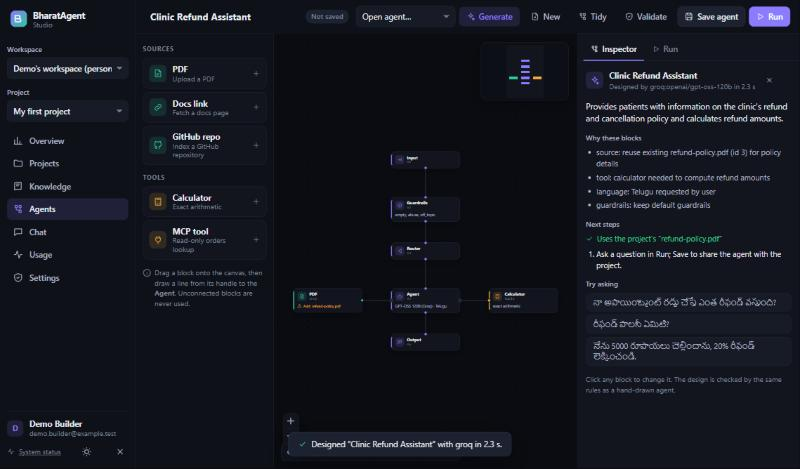
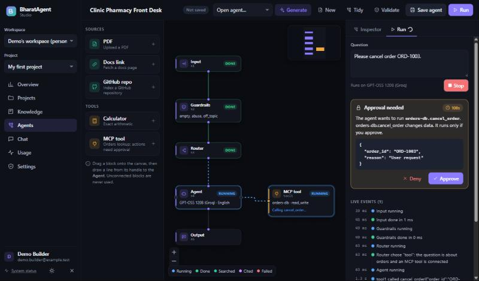
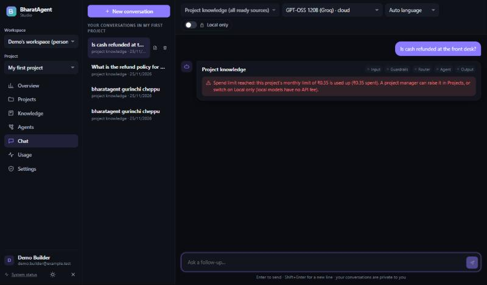
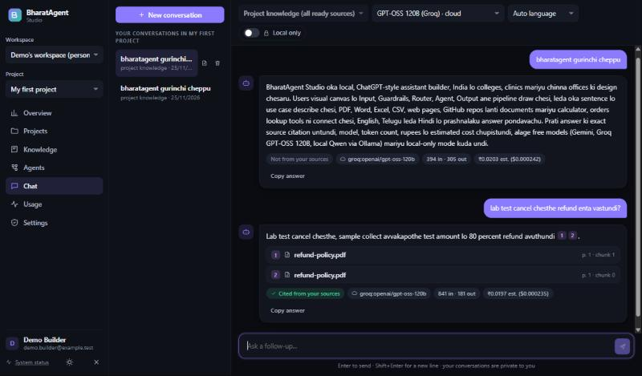
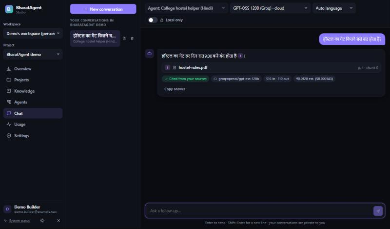
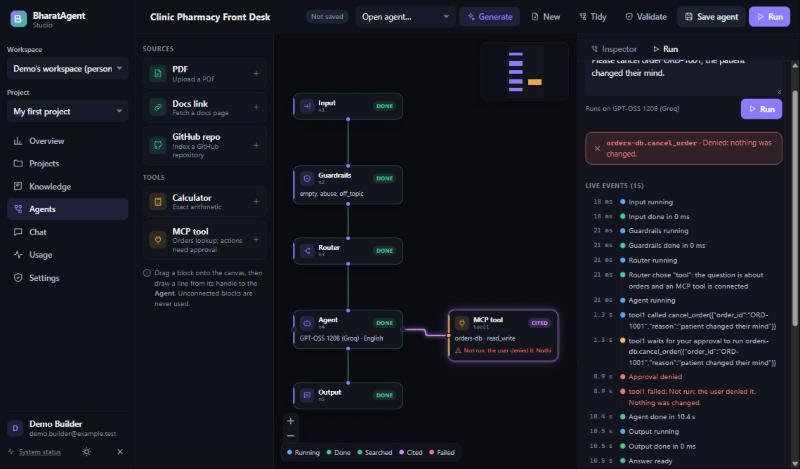

# BharatAgent Studio

**Build your own AI assistant over your own documents and tools, in English, Telugu or Hindi, on free models.**

> **This repository is the hackathon prototype.** The full product it leads to is specified in
> [docs/final-product/PRD.md](docs/final-product/PRD.md) (product requirements) and
> [docs/final-product/README.md](docs/final-product/README.md) (the final product's README). This page shows what
> the prototype already does and what is left for the final product.

Built for **AI for Bharat**: colleges, clinics and small offices that want an assistant over their own files,
with control over privacy and spending.



## Prototype and final product

| | Prototype (this repository) | Final product ([PRD](docs/final-product/PRD.md)) |
|---|---|---|
| Goal | Prove the core idea end to end: build an agent, connect knowledge, ask, get a cited answer, with safety and cost control | A complete, self-hostable platform for dynamic agentic assistants |
| Coverage | About 60% of the 48 functional requirements of the PRD | All of them |
| Models | Free only: Groq (GPT-OSS 120B), Gemini Flash, local Qwen through Ollama | As specified in the PRD |
| Status | Runs today with one command (`docker compose up`) | Planned; see [What is left](#what-is-left-for-the-final-product) |

## Main features of the prototype

1. **Describe it, get an agent.** One sentence ("Answer patient questions about our refund policy in Telugu")
   becomes a validated agent on the canvas in about 2 seconds: sources, tools, language, guardrails, role and
   example questions. It reuses documents already in the project.
2. **Visual agent builder.** Input → Guardrails → Router → Agent → Output; drag in PDFs, docs links, GitHub
   repos, a calculator or an MCP tool and draw a line to the Agent. Every block lights up live while it runs.
3. **Answers only from your knowledge, with citations.** PDF, Word, Excel, CSV, Markdown, text, docs pages and
   GitHub repos. Every sentence must cite its source, and sentences the source does not support are removed.
4. **Indian languages.** English, Telugu and Hindi, in their own script or typed in English letters
   ("refund enta vastundi?", "refund kitna milega?"), answered the same way.
5. **Free models that do not stall.** Groq ↔ Gemini → local Qwen: if one model fails or runs out of free quota,
   the next answers, and the answer says so. **Local only** keeps every question and document on the computer.
6. **Tools with human approval.** A calculator and an orders system (MCP). An action that changes data, such as
   cancelling an order, waits for the user to click **Approve**; Deny or no answer changes nothing.
7. **Cost control.** Tokens and estimated cost in rupees on every answer, a usage dashboard, and spend limits per
   project and per conversation (warning at 80%, stop at 100%).
8. **Teams.** Accounts, company workspaces, roles, invitations, shared projects and private conversations, with
   every request checked on the server.

| Generate an agent | Approval before an action | Spend limit |
|---|---|---|
|  |  |  |
| **Telugu in English letters** | **Hindi agent, cited** | **Denied action** |
|  |  |  |

## What is left for the final product

The main pieces of the [PRD](docs/final-product/PRD.md) that the prototype does not have yet:

- **Database connections**: Postgres, MySQL, SQLite and MongoDB, with tested and encrypted credentials, rules
  for who may add and use a connection, read-only by default, a SQL guard, and approval before any write.
- **Sign in with GitHub and Google**, and private GitHub repositories as knowledge through the GitHub sign-in.
- **A model-driven agent**: the model plans over several steps (search, query a database, calculate, answer)
  instead of the prototype's fixed router, with subagents and turn limits.
- **Open tools and MCP**: web search, HTTP requests, date and time, and any MCP server added from the UI.
- **Versions**: publish an agent, keep its history and compare versions.
- **Better retrieval**: keyword and vector search together with reranking, background ingestion, object storage.
- **Operations**: evals in the app, audit log, API tokens, rate limits, HTTPS and monitoring.

## Run it

Windows with Docker Desktop (PowerShell):

```powershell
Copy-Item .env.example .env     # add your GROQ_API_KEY, GEMINI_API_KEY and a database password
docker compose up -d --build
docker compose exec ollama ollama pull bge-m3          # embeddings (needed for documents)
docker compose exec ollama ollama pull qwen2.5:3b      # optional: local model for Local only and offline fallback
powershell -ExecutionPolicy Bypass -File scripts\demo-setup.ps1   # optional: demo account, documents, 3 agents
```

Open http://localhost:3000. The demo setup prints the sign-in email (the password is in `.env.demo-account`) and
questions to try. Run every test (api, database and web) with
`powershell -ExecutionPolicy Bypass -File scripts\test-all.ps1`.

## Learn more

- [docs/TECHNICAL_DETAILS.md](docs/TECHNICAL_DETAILS.md): how every part works, the API, models, tests and backups
- [docs/DEMO.md](docs/DEMO.md): a step-by-step demo
- [docs/final-product/PRD.md](docs/final-product/PRD.md) and [docs/final-product/README.md](docs/final-product/README.md): the final product
- [PHASES.md](PHASES.md): how the prototype was built, phase by phase

Costs shown are estimates from a price table, not a bill. The clinic orders and sample documents are fictional.
